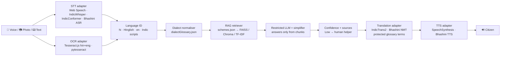

# 🎙️ बोलो योजना · Bolo Yojana

**हर योजना, आपकी भाषा में** — *Every scheme, in your language.*

A voice-first, multilingual AI assistant that helps rural and semi-literate citizens in Madhya Pradesh and the Hindi belt understand government schemes. It checks eligibility, lists the documents to carry, and helps fill forms in Hindi, Hinglish, English and local dialects (Malwi, Bundeli, Nimadi).

> Theme: **Multilingual AI & Language Technologies**. Three schemes are covered in depth: **PM-Kisan**, **Ayushman Bharat (PM-JAY)** and **Ladli Behna Yojana (MP)**.

---

## ✨ What's inside

| # | Feature | Where |
|---|---|---|
| 1 | **Code-mixed (Hinglish) understanding.** *"mera kisan wala paisa nahi aaya, kya karu?"* gets a reply in the same style | `services/nlp/languageDetect.js`, `services/rag.js` |
| 2 | **Dialect normalisation.** 65-term Malwi/Bundeli/Nimadi glossary mapped to standard Hindi, with a "Dialect detected: Malwi" badge | `data/dialectGlossary.json`, `services/nlp/dialect.js` |
| 3 | **Voice-first.** Big mic, hands-free question loops, every answer auto-spoken, a 🔊 *Read aloud* button on all text | `hooks/useVoice.js`, `components/ui.jsx` |
| 4 | **Simplification, not just translation.** An *Original vs Simple* toggle on every scheme and every scanned notice | `pages/Schemes.jsx`, `services/nlp/simplify.js` |
| 5 | **RAG over verified data only.** Each answer carries a 📎 source chip and a last-verified date. If the data has no answer, it says *"Mujhe iski pakki jaankari nahi hai"* | `services/rag.js`, `backend/app/rag.py` |
| 6 | **Confidence scoring + human fallback.** 🟢/🟡/🔴 on every answer; a Low answer shows *Talk to a human helper* | `components/HumanHelperModal.jsx` |
| 7 | **Automatic language detection** (hi / Hinglish / en + 8 Indic scripts) with a manual override dropdown | settings ⚙️ and the Assistant header |
| 8 | **Domain glossary.** Aadhaar, e-KYC, Patwari, Samagra ID and similar terms are never translated, and you can tap one to see what it means | `data/domainGlossary.json`, `services/nlp/glossary.js` |
| 9 | **Lite mode + PWA.** Installable, works offline, scheme data cached, no animations or images in Lite mode | `public/sw.js`, `public/manifest.webmanifest` |
| 10 | **WhatsApp-style theme** and a mock *Continue on WhatsApp* flow | `pages/WhatsApp.jsx` |
| 11 | **Adapter layer for Indian AI models**: Bhashini, IndicTrans2, IndicWhisper/IndicConformer | `services/adapters/*`, `backend/app/adapters/*` |
| 12 | **Cultural localisation**: ₹1,50,000, "डेढ़ लाख", Indian dates, respectful *aap* | `services/format.js` |
| 13 | **Live two-way conversation**: citizen (Hindi/Malwi) ⇄ official (English) on a split screen with waveforms and a face-to-face flip | `pages/Conversation.jsx` |
| 14 | **Photo-to-voice**: Tesseract.js OCR (hin+eng) → simplify → key facts → translate → speak. Two sample notices are included | `pages/Scanner.jsx`, `public/samples/` |
| 15 | **Accessibility**: high contrast, 5 font sizes, screen-reader labels, 48px targets, a sign-language avatar placeholder on the roadmap | ⚙️ settings, Trust page |
| 16 | **Guided form filling**: each field is asked by voice, then a summary PDF with a document checklist is generated on the device | `pages/FormFill.jsx`, `services/pdfSummary.js` |
| 17–20 | **Privacy badge, impact dashboard, architecture/scalability story, source transparency** | `pages/Impact.jsx` |
| ★ | **Demo Mode**: a scripted "Sunita from Vidisha" walkthrough that runs with no internet, mic or API keys | `data/demoScript.js` |

---

## 🚀 Quick start

### Frontend only (zero keys, works offline)

```bash
cd frontend
npm install
npm run dev          # http://localhost:5173
# production build + PWA
npm run build && npm run preview   # http://localhost:4173
npm test             # core NLP / RAG / eligibility tests (Node test runner)
```

Use **Chrome on Android or desktop** for voice input (Web Speech API). Hindi voices for speech output come from the device; on Android, Google TTS provides `hi-IN`.

### With the FastAPI backend (optional)

```bash
cd backend
python -m venv .venv && source .venv/bin/activate
pip install -r requirements.txt            # core: no GPU, no keys
# optional: pip install -r requirements-ml.txt   (Claude, FAISS, sentence-transformers, pytesseract)
cp .env.example .env                       # add keys if you have them (CORS_ORIGIN_REGEX optional)
uvicorn app.main:app --reload --port 8000
python -m pytest -q                        # API tests

# then point the frontend at it
cd ../frontend && echo "VITE_API_URL=http://localhost:8000" > .env.local && npm run dev
```

Every frontend call goes through `src/services/api.js`. If the backend is down, slow or returns an error, the app **silently falls back to the in-browser implementation**, so the demo can't break.

---

## 🎬 Stage demo script (about 3 minutes)

1. **Landing**: tap **🎬 सुनीता का डेमो देखें**. Demo Mode switches on and the Assistant opens.
2. Sunita speaks in Malwi: *"म्हारो नाम सुनीता है… लाड़ली बहना को पइसो म्हने मिलेगो कि नी?"*
   - The **Dialect detected: Malwi** badge appears, with the normalised Hindi line *"समझा: मेरा नाम सुनीता है…"*
   - The answer comes from verified data, with a 🟢 confidence badge and a 📎 `cmladlibahna.mp.gov.in` source chip.
3. The assistant asks 9 eligibility questions **by voice**, one at a time, and Sunita answers in dialect (*"हओ"*, *"नी"*, *"कोनी"*, *"डेढ़ लाख"*). The result is **✅ eligible**, with the document checklist shown as icons and read aloud.
4. She asks *"पइसो नी आयो तो कई करनो?"* and gets the payment-status steps plus the 181 helpline.
5. **📝 Fill form** builds a voice-guided form and downloads a summary PDF.
6. **🤝 Live Talk → Play demo**: Sunita (Malwi) ⇄ Block Officer (English), each hearing the other translated.
7. **📷 Scan → sample notice**: the official Hindi notice is turned into "⏰ last date 31/10/2026, 📍 go to CSC, 🎒 carry Aadhaar…" and spoken.
8. **📊 Trust**: metrics, cost per query, architecture, privacy and sources.

Use **⏭️ Next** to skip ahead and **⏹️ Stop** to end the demo. Turn on Lite mode (⚙️) to show the low-bandwidth experience.

---

## 🏗️ Architecture



**Design rule: data and adapters, never rewrites.**

- **New dialect**: add entries to `frontend/src/data/dialectGlossary.json`. The badge and normalisation work immediately in both the frontend and the backend.
- **New language**: add a text key (e.g. `"mr"`) to the scheme JSON and point the STT/TTS/translation adapters at a model that supports it (Bhashini covers 22 languages).
- **New scheme**: add one object to `schemes.json`. Eligibility questions, rules, form fields, FAQs and documents are all data.
- **New intent synonym**: add it to `intents.json`, which the browser and Python retrievers share.

### Project layout

```
frontend/
  src/
    data/            schemes.json · dialectGlossary.json · domainGlossary.json · intents.json · demoScript.js · sampleNotices.js
    services/
      api.js         service facade: backend first, in-browser fallback
      rag.js         grounded retrieval + answer + confidence
      eligibility.js rule engine + spoken-answer parser (हाँ / नी / डेढ़ लाख …)
      format.js      ₹ / lakh / crore / Indian dates / spoken amounts
      nlp/           languageDetect · dialect · glossary · simplify · extract (notice key facts)
      adapters/      stt · tts · translate · ocr   ← plug Bhashini / AI4Bharat here
      pdfSummary.js  canvas-rendered Devanagari → PDF
    pages/           Landing · Assistant · Schemes · Eligibility · FormFill · Scanner · Conversation · Impact · WhatsApp
  public/            sw.js (offline) · manifest · icons · samples/ (2 notice images)
  tests/             node --test suite
backend/
  app/
    main.py          FastAPI endpoints
    rag.py           chunking + FAISS / Chroma / TF-IDF + grounded answers
    nlp.py           Python port of detection / dialect / glossary / simplify
    eligibility.py   same rule engine as the frontend
    adapters/        llm.py (Claude) · bhashini.py (ASR/NMT/TTS) · indictrans.py (IndicTrans2)
  tests/             pytest suite
```

---

## ☁️ Deploy on Render

`render.yaml` is a Render Blueprint that creates both services at once:

1. In the Render dashboard, choose **New → Blueprint** and pick this repo.
2. Render asks for the secret values `ANTHROPIC_API_KEY`, `BHASHINI_USER_ID` and `BHASHINI_API_KEY`. All are optional; leave them blank to run without keys.
3. Click **Apply**. You get:
   - `bolo-yojana-api`: the FastAPI Web Service (free plan, health check `/health`)
   - `bolo-yojana`: the static PWA, built with the backend URL baked in

**If Render adds a suffix to a URL** (because the name is taken):
- **Backend URL changed:** update `VITE_API_URL` on the `bolo-yojana` static site and redeploy it. `VITE_*` values are read at build time.
- **Frontend URL changed:** nothing to do. `CORS_ORIGIN_REGEX` already accepts `https://bolo-yojana-<suffix>.onrender.com`.

Free-tier backends sleep after about 15 minutes idle. While the backend wakes up, the app answers in the browser, so nothing breaks. Open `/health` on the backend before a demo to wake it. Never put secrets in `VITE_*` variables, because they end up in public JavaScript.

---

## 🔌 API (FastAPI)

| Method | Path | Purpose | Without keys |
|---|---|---|---|
| GET | `/health` | status, vector store, LLM, Bhashini | ✅ |
| POST | `/detect-language` | `{text}` → lang + dialect + normalised text | ✅ |
| POST | `/ask` | `{text, lang_override, context_scheme_id}` → grounded answer, confidence, sources | ✅ (answer from data) |
| POST | `/simplify` | `{text, lang}` → 5th-grade rewrite | ✅ (rule-based) |
| POST | `/translate` | `{text, source, target}` | 503 → client uses offline phrasebook |
| POST | `/eligibility` | `{scheme_id, answers}` → `eligible / not_eligible / need_info` or next question | ✅ |
| POST | `/ocr` | multipart image → text | 501 → client uses Tesseract.js |
| POST | `/tts` | `{text, lang}` → base64 WAV | 501 → browser SpeechSynthesis |
| POST | `/stt` | `{audio_base64, lang}` → transcript | 501 → Web Speech API |

Interactive docs are at `http://localhost:8000/docs`.

---

## 🇮🇳 Plugging in Bhashini / AI4Bharat

| Capability | Prototype (default) | Production adapter | How to switch |
|---|---|---|---|
| Speech → text | Web Speech API (`hi-IN`, `en-IN`) | **Bhashini ASR** (IndicConformer) or self-hosted **IndicWhisper** | backend `.env`: `BHASHINI_USER_ID`, `BHASHINI_API_KEY`; frontend: `VITE_STT_PROVIDER=backend` |
| Translation | Offline phrasebook + dictionary | **Bhashini NMT** or **IndicTrans2** (`ai4bharat/indictrans2-*-dist-200M`) or LLM | `TRANSLATE_PROVIDER=auto\|bhashini\|indictrans2\|llm`; frontend `VITE_TRANSLATE_PROVIDER=backend` |
| Text → speech | Browser SpeechSynthesis | **Bhashini TTS** (Indic-TTS) | `VITE_TTS_PROVIDER=backend` |
| Answers / simplification | Data-only templates + rule simplifier | **Claude** (`claude-opus-5-5`, configurable `LLM_MODEL`), restricted to retrieved chunks | `ANTHROPIC_API_KEY=…` + `pip install anthropic` |
| Retrieval | TF-IDF (pure Python) / browser keywords | **FAISS** + multilingual sentence-transformers, or **ChromaDB** | `pip install faiss-cpu sentence-transformers` → `VECTOR_STORE=auto` |
| OCR | Tesseract.js in the browser | pytesseract / Bhashini OCR | install `pytesseract` + the Tesseract binary with `hin` data |

- **Bhashini flow** (`backend/app/adapters/bhashini.py`): one `getModelsPipeline` config call returns the inference endpoint, auth header and `serviceId`, which are cached. Then one inference call per request for `asr`, `translation` or `tts`. Check field names against the current ULCA docs when you get credentials.
- **IndicTrans2** (`backend/app/adapters/indictrans.py`) loads lazily and needs `transformers`, `torch` and `IndicTransToolkit`.
- **Protected terms**: before any machine translation, glossary terms are replaced with `[[n]]` placeholders and restored afterwards, so *Aadhaar* never turns into "foundation".
- **LLM guardrails**: the system prompt allows only facts inside `<context>`, requires the "pakki jaankari nahi" sentence when unsure, uses short sentences and Indian formats, and forbids markdown because the output is spoken. A refusal, timeout or missing key falls back to the verified template answer. Server-side `fallbacks: "default"` is enabled for safety-classifier declines.

---

## 📚 Data format (`schemes.json`)

Each scheme has: `name / tagline / simple / original` text in `hi` (Hindi), `hl` (Hinglish) and `en`; `benefit`; `eligibility.yes / no`; `documents[]` (with icons); `steps`; `faqs[]` (keywords + answers); `questions[]` (eligibility flow: `yesno | number | amount | choice`); `rules[]` (`{ if: {q, op, value}, then: not_eligible | eligible | eligible_final | note, reason }`); `default`; `form[]`; plus `officialUrl`, `sourceName`, `lastVerified` and `helpline`.

Official sources: [pmkisan.gov.in](https://pmkisan.gov.in/) · [pmjay.gov.in](https://pmjay.gov.in/) / [beneficiary.nha.gov.in](https://beneficiary.nha.gov.in/) · [cmladlibahna.mp.gov.in](https://cmladlibahna.mp.gov.in/)

> ⚠️ **Prototype data.** Amounts and rules were compiled from the official portals for this hackathon. Re-verify them against the official sites before real-world use, and update `lastVerified`. For example, the Ladli Behna amount is recorded as ₹1,500/month (from November 2025, previously ₹1,250).

---

## 🔒 Privacy

- **No voice is recorded or stored.** Speech recognition uses the browser engine. The optional `/stt` endpoint processes audio in memory only.
- Form details stay in memory, and the PDF is drawn on the device.
- Only anonymous counters (query count, language) are kept in `localStorage`.
- With a backend, only the question text is sent: no audio and no identity.

## ✅ Reliability & error handling

- Every network call has a timeout and an in-browser fallback (`services/api.js`).
- Speech never blocks the flow: TTS promises always resolve, with a safety timer for browsers that never fire `onend`.
- Friendly bilingual messages for mic permission, no speech, no internet, and unsupported browsers. A text box is always available.
- An error boundary around each page means one broken widget can't blank the app.
- The OCR engine is lazy-loaded with a timeout. Sample notices fall back to their known text if the engine can't load (for example, offline before first use).
- Demo Mode runs entirely offline through the real pipeline with scripted input.

## ⚠️ Known limitations (honest notes)

- Chrome's Web Speech recognition sends audio to Google's speech service and needs internet. For on-premise use, use the `backend` STT provider (Bhashini or IndicWhisper).
- The offline translator is a phrasebook tuned to the citizen–official demo. Open-domain translation needs IndicTrans2 or Bhashini.
- Impact-dashboard numbers are **illustrative mock pilot projections** and are labelled as such. The "Live on this device" counters are real.
- Tesseract.js downloads its engine and language data from jsDelivr on first use. To make it fully offline, self-host them with the `VITE_TESSERACT_*` env vars.
